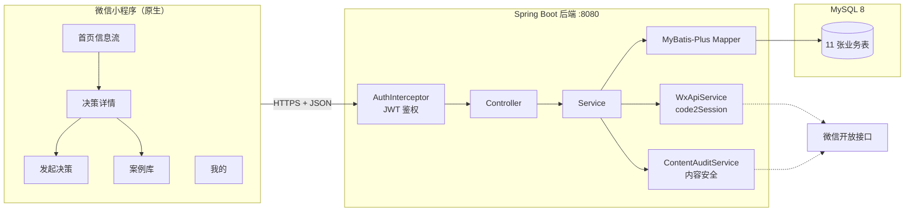

# 路口 · decision-vote

> 让走过这条路的人告诉你结果，而不是让陌生人替你数票。

一个面向**重大人生决策**的微信小程序：发起决策 → **盲投** → 全网补充**方案** → 采纳得**星星标签** → 事后**回访结局** → 沉淀为**案例库**。

[](https://openjdk.org/projects/jdk/21/)
[](https://spring.io/projects/spring-boot)
[](https://www.mysql.com/)
[](https://developers.weixin.qq.com/miniprogram/dev/framework/)
[](LICENSE)

---

## 为什么做这个

人生里的重大选择——要不要辞职读研、要不要接降薪 offer、要不要回老家——几乎都没有标准答案，只有「适不适合你」。

市面上的投票类产品都在**数人头**：让陌生人投票，票数最高的就是答案。但 100 个路过的人投的一票，凭什么等同于一个真正走过这条路的人讲的一段真实后果？

所以这个项目要做的事情不一样：**不优化投票体验，而是优化建议的可信度**。

| 常见做法 | 本项目 |
|---|---|
| 实时展示票数，后来者跟票 | **盲投**：投完才揭晓，切断从众效应 |
| 只能在发起者给的 A/B/C 里选 | **补充方案**：用户可以提出发起者没想到的第三条路 |
| 平台自己认证「专家」 | **采纳即得星**：方案被发起者采纳累积星星，系统按领域自动打标签 |
| 决策结束即话题结束 | **结局回访**：3/6/12 个月后追问「你后悔吗」，沉淀为案例 |
| 帖子沉底后不可检索 | **案例库**：相似决策自动推荐历史案例 |

最后一条是核心壁垒：**别人的热度会过期，但「和我相似的人选了 A，两年后 60% 说值得」这种数据会随时间复利增长。**

---

## 核心机制

### 1. 盲投（Blind Vote）

未投票用户在详情页只能看到 `已有 N 人参与`，看不到任何选项的票数分布；投票成功后同一请求立刻返回完整分布。

- 不显示人数会让人觉得「投进黑盒」，所以**显示人数、隐藏分布**。
- 后端在 `PostService.buildCards` 中判定 `blind`：`作者 || 已投票 || 已截止` 任一成立才揭晓。
- 前端 `detail.js` 投票成功后直接复用投票接口返回的帖子对象刷新本页，无需二次请求。

### 2. 补充方案 + 采纳 + 星星标签

```
用户提交方案 → 其他用户点赞（参考权重）→ 发起者拍板采纳 → 方案作者 +1 星，系统打领域标签
```

- 采纳权只归发起者（保含金量），点赞数作为决策依据展示，不直接决定结果。
- 星星与标签**由系统按被采纳方案所属场景累计**，不允许用户自封，避免「人生导师」标签贬值。
- 采纳后方案置顶展示。

### 3. 结局回访 → 案例库

发起者在决策落地后回填：最终选了哪个、结果如何（`值得 / 后悔 / 还在观察`）与补充说明。回填后该决策自动进入案例库，并参与相似推荐。

到期时不等用户自己想起来——「我的」页可开启一次性订阅提醒，后端每天 10:00 把「该说说结果了」推到微信服务通知，点开直达该决策。

### 4. 相似案例推荐

发起决策页顶部会调 `/api/cases/similar` 展示同类决策的历史案例，让用户在提问前先看到「别人走过这条路，后来怎样」。

---

## 架构



**请求约定**：除 `/api/auth/login`、`/api/health` 外均需 `Authorization: Bearer <token>`；统一响应体 `{code, msg, data}`，`code=0` 为成功。

---

## 技术栈

| 层 | 技术 |
|---|---|
| 后端 | Java 21 · Spring Boot 3.2.5 · MyBatis-Plus 3.5.5 · JWT (jjwt) · MySQL 8 |
| 前端 | 微信原生小程序（无框架、无 npm 依赖） |
| 构建 | Maven Wrapper（自带 `mvnw`，无需预装 Maven） |
| 部署 | 自建服务器 + HTTPS + 已备案域名 |

---

## 界面与设计


整体走**暖色调**：赤陶橙主色 `#B9562C` 配米白底 `#FDF8F2`，避开工具类产品常见的冷蓝灰，让「聊人生选择」这件事本身有点温度。

图标是**分岔路口**——底部节点是「现在的你」，向上走到分岔点，分成两条方向。刻意不画标准答案，因为产品的主张正是重大决策没有标准答案。三个节点与「起点 → 决策 → 选项」的结构同构。

全部图形由 `scripts/gen_icons.py` 程序化生成，改配色可一键复现，详见 [图标资产说明](miniprogram/assets/icons/README.md)。

---

## 目录结构

```
decision-vote/
├── backend/                          Spring Boot 后端（74 个 Java 文件）
│   ├── mvnw / mvnw.cmd               Maven Wrapper
│   ├── pom.xml
│   └── src/main/
│       ├── java/com/lukou/decision/
│       │   ├── common/               统一响应体、分页、全局异常
│       │   ├── config/               鉴权拦截器、CORS、Jackson、微信配置
│       │   ├── controller/           10 个 Controller
│       │   ├── dto/                  请求/响应对象
│       │   ├── entity/               12 个实体
│       │   ├── mapper/               MyBatis-Plus Mapper
│       │   ├── service/              业务逻辑
│       │   └── util/                 JWT、用户上下文
│       ├── resources/
│       │   ├── application.yml
│       │   ├── db/schema.sql         建库建表脚本
│       │   └── static/admin/         举报处置后台（reports.html）
│       └── uploads/                  头像等用户上传（gitignore，需备份）
├── miniprogram/                      微信小程序（6 个页面）
│   ├── app.js / app.json / app.wxss
│   ├── project.config.json
│   ├── config.js                     后端地址（dev / lan / tunnel / prod + auto 自动选路）
│   ├── utils/api.js                  请求封装 + 全部接口定义
│   └── pages/
│       ├── index/                    首页信息流（场景筛选、下拉刷新、上拉加载）
│       ├── detail/                   决策详情（盲投、方案、建议、回访）
│       ├── create/                   发起决策（选项动态增删、相似案例推荐）
│       ├── cases/                    案例库（搜索、筛选、分页、结局分布）
│       ├── profile/                  我的（星星标签、经历档案、待回访、提醒）
│       └── login/                    微信登录（协议勾选、头像昵称选填）
├── scripts/
│   ├── smoke_test.py                 接口链路自测（51 项断言）
│   ├── tunnel.sh                     公网隧道（域名轮换时自动写回 config.js）
│   └── usb.sh                        USB 直连（adb reverse，手机走流量时最稳）
└── docs/
    ├── 01-需求文档.md
    ├── 02-项目文档.md
    └── features/                     按功能维护：13 个模块 × (功能逻辑说明 + 改动记录)
```

---

## 快速开始

### 1. 初始化数据库

```bash
mysql -u root -p < backend/src/main/resources/db/schema.sql
```

脚本会创建 `decision_vote` 库与 11 张表（幂等，可重复执行）。

### 2. 启动后端

```bash
cd backend
./mvnw spring-boot:run          # macOS / Linux / Git Bash
.\mvnw.cmd spring-boot:run      # Windows CMD / PowerShell
```

健康检查：

```bash
curl http://localhost:8080/api/health
# {"code":0,"msg":"ok","data":{"status":"up"}}
```

### 3. 跑一遍接口链路（可选，推荐）

```bash
python scripts/smoke_test.py
```

用两个测试账号跑完「发布 → 盲投 → 投票 → 方案 → 点赞 → 采纳 → 星星 → 建议 → 回访 → 案例库 → 相似推荐」，逐项打印 PASS/FAIL。

### 4. 打开小程序

微信开发者工具导入 `miniprogram` 目录：

- AppID 见 `miniprogram/project.config.json`（须与小程序后台一致，否则提示无权限）
- `urlCheck` 已关闭，导入即可跑；后端地址集中在 **`miniprogram/config.js`**：

| ENV | 行为 | 用在什么时候 |
|---|---|---|
| `auto`（默认） | 启动时并发探测 `AUTO_ORDER` 里的地址，谁先通走谁 | 日常开发。平时自动走局域网，连不上自动退回隧道 |
| `dev` | `http://localhost:8080` | 只在开发者工具模拟器里 |
| `lan` | `http://<电脑内网IP>:8080` | 强制局域网（手机与电脑**同 WiFi**） |
| `tunnel` | 公网 `https://xxx.lhr.life` | 手机连不上内网时（不同 WiFi / WiFi 开了客户端隔离） |
| `prod` | 已备案 HTTPS 域名 | 上线 |

> **真机一定不能用 `dev`**：`localhost` 在手机上指向手机自己，必然报「网络异常」。
>
> **`auto` 模式的选路顺序**：先 `HOSTS.lan`（局域网，1.2 秒超时），连不上再 `HOSTS.tunnel`（公网隧道，8 秒超时）。选中的地址会缓存，请求失败会自动清空重选，所以换了 WiFi、IP 变了都不用改代码 —— 只要把新 IP 填进 `HOSTS.lan` 即可。
>
> **局域网直连失败最常见的原因不是配置，是网络**：公司/共享 WiFi 普遍开了 **客户端隔离（AP Isolation）**，同一个网段也互相 ping 不通；真机调试面板右侧「连接方式」如果显示「**其他**」而不是「局域网」，基本可以确认手机没在电脑的局域网里。这种情况怎么改 IP 都没用，走隧道。
>
> **隧道域名变了不用改代码**：进小程序「我的」页，顶部有一张**服务器地址**卡片（`prod` 环境不显示），点「修改地址」把新域名粘进去即可，立即生效、无需重新编译。这是为免费隧道设计的——域名会轮换，但改一次只要 5 秒。
>
> **手机走流量、连不上电脑时，优先用 USB 直连（最稳）**：手机与电脑没有任何网络交集，内网 IP 永远不可达。用数据线把手机连上电脑，手机开「开发者选项 → USB 调试」，然后 `bash scripts/usb.sh`——它会把手机的 `localhost:8080` 转发到电脑的 8080。再在小程序「我的 → 服务器地址」填 `http://localhost:8080` 即可。不经过网络、不用注册、永不掉线，拔线重插后重跑一次脚本。
>
> **开隧道**：`bash scripts/tunnel.sh`，等它打印 `https://xxxx.lhr.life`。脚本会**自动把新域名写回 `config.js`**，域名轮换时不用手动改。窗口关掉隧道就断。免费隧道只适合联调，带宽有限且域名会轮换。
>
> **关于固定域名**：免费隧道都做不到永久固定。`localhost.run` 实测 12–18 分钟就轮换一次，`cpolar` 免费版 24 小时轮换，固定二级子域名需付费。所以真正的解法是 USB 直连，或上面的「手动填地址」入口，而不是追求一个永不变的域名。

#### 控制台报错自查

| 现象 | 原因 | 处理 |
|---|---|---|
| `[ WXSS 文件编译错误]` 且不带文件名 | 基础库用了**灰度版**（如 3.18.1）+ 新工具的 Builder 服务崩溃；项目代码出错时会带文件名和行列 | 「详情 → 本地设置 → 调试基础库」切稳定版；不要用 `project.private.config.json` 的 `libVersion` 钉灰度版 |
| `getRootFactory Not Define Env Error` | 同上，Builder 随编译器一起崩了 | 同上；改完必须**完全退出工具**（结束进程）再打开，只重新编译不会重载配置 |
| `工具未校验合法域名...` + `api.js` 一长串调用栈 | 这是**警告不是报错**：`urlCheck=false` 时请求合法通过，栈是这次请求的调用链 | 无需处理 |
| 真机全部接口 `request:fail fail:time out` | 请求根本没到电脑（`time out` 是被丢包，不是被拒绝）。多数是手机不在电脑局域网 / WiFi 客户端隔离 / IP 变了 | 看真机面板「连接方式」；`curl http://内网IP:8080/api/health` 自测；通不了就 `bash scripts/tunnel.sh` 走隧道 |
| 真机「网络异常（连不上 x.x.x.x:8080）」 | `ENV` 还是 `dev`、内网 IP 变了、手机不在同一 WiFi、或防火墙拦了 8080 | 改 `config.js` 的 `HOSTS.lan`；或切 `ENV='tunnel'` |
| 「网络异常（都连不上：a / b）」 | `auto` 把所有候选都试过了 | 后端没启动，或隧道断了，按提示里的地址逐个 `curl` |
| 接口 401 | token 过期或未登录 | 清缓存重进，前端会自动重新静默登录 |

---

## 部署

线上形态：**自建 Linux 服务器 + 已备案域名 + HTTPS + 微信小程序**。逐条命令、Nginx/systemd 配置模板与运维脚本见 [项目文档 · 生产部署流程](docs/02-项目文档.md#12-生产部署流程)。

> **ICP 备案是唯一无法压缩的步骤**（个人主体 7–20 个工作日），第一天就启动，其余步骤与备案并行。

### 六个步骤

| 步骤 | 做什么 |
|---|---|
| 1 | 买域名 + 服务器，提交备案；安全组放行 22 / 80 / 443，**不放行 8080** |
| 2 | 服务器装 JDK 21 / MySQL 8 / Nginx；本地 `./mvnw clean package -DskipTests` 得到 `decision-vote-1.0.0.jar` |
| 3 | 执行 `schema.sql` 建库，建专用 DB 账号（不要用 root 跑应用） |
| 4 | 传 jar 到 `/opt/decision-vote/app.jar`，写 `.env`，systemd 托管并设开机自启 |
| 5 | Nginx 反代 `127.0.0.1:8080`，`certbot` 签 HTTPS 证书并配置自动续期 |
| 6 | 小程序 `BASE_URL` 改为 `https://域名/api` → 后台配合法域名 → 上传提审 → 发布 |

### 生产环境变量

```bash
DB_USERNAME=dvapp
DB_PASSWORD=<强密码>
SPRING_DATASOURCE_URL=jdbc:mysql://localhost:3306/decision_vote?useUnicode=true&characterEncoding=utf8&serverTimezone=Asia/Shanghai&useSSL=false&allowPublicKeyRetrieval=true
JWT_SECRET=<openssl rand -hex 32 生成>
WX_APPID=<真实 AppID>
WX_SECRET=<真实 AppSecret>
WX_MOCK=false
AUDIT_MOCK=false
ADMIN_TOKEN=<随机长串>
FOLLOW_UP_TMPL_ID=<订阅消息模板 ID，可留空>
UPLOAD_DIR=/opt/decision-vote/uploads
UPLOAD_PUBLIC_BASE=
```

`UPLOAD_DIR` 必须可写并纳入备份；头像存本机磁盘，多实例部署要换对象存储或共享盘。

`SPRING_DATASOURCE_URL` **必须显式设置**：`application.yml` 里的数据源 URL 写死了 `localhost:3306`，靠环境变量覆盖（Spring Boot 环境变量优先级高于配置文件），MySQL 不在本机时改这里的 host。

### 三个容易踩的坑

1. **备案没下来就配合法域名** —— 小程序会直接拒绝；备案期间先用 IP 自测后端接口。
2. **8080 暴露到公网** —— 只让 Nginx 的 443 对外，后端仅监听 `127.0.0.1:8080`。
3. **忘了关 mock** —— `WX_MOCK=false` 才走真实微信登录，`AUDIT_MOCK=false` 才调内容安全；后者还需把**服务器出口 IP** 加入公众平台的 IP 白名单，否则审核和线上都会有问题。

### 验证与回滚

```bash
curl https://你的域名/api/health
# {"code":0,"msg":"ok","data":{"status":"up"}}

echo | openssl s_client -connect 你的域名:443 2>/dev/null | openssl x509 -noout -dates
```

回滚只需替换 jar 并重启，**不要动数据库结构**：

```bash
cp /opt/decision-vote/app.jar.bak /opt/decision-vote/app.jar
systemctl restart decision-vote
```

---

## 接口清单

| 模块 | 方法 | 路径 | 鉴权 | 说明 |
|---|---|---|---|---|
| 登录 | POST | `/api/auth/login` | ✗ | `wx.login` 的 code 换 token，mock 模式下用 code 直接生成 openid |
| 健康 | GET | `/api/health` | ✗ | 存活检查 |
| 上传 | POST | `/api/files/avatar` | ✓ | 头像上传（jpg/png/webp ≤2MB，按文件头判类型） |
| 场景 | GET | `/api/scenes` | ✗ | 预设 8 个 + 站内热门自定义场景 |
| 决策 | POST | `/api/posts` | ✓ | 发起决策（标题/描述/场景/2–6 选项/匿名/期限） |
| 决策 | GET | `/api/posts/feed` | ○ | 信息流分页，可按场景筛选 |
| 决策 | GET | `/api/posts/{id}` | ○ | 详情聚合：选项、票数（受盲投控制）、方案、建议、回访 |
| 决策 | GET | `/api/posts/mine` | ✓ | 我发起的 |
| 决策 | GET | `/api/posts/voted` | ✓ | 我参与过的 |
| 投票 | POST | `/api/posts/{id}/vote` | ✓ | 投票，唯一约束防重复，返回揭晓后的详情 |
| 方案 | POST | `/api/posts/{id}/solutions` | ✓ | 提交补充方案 |
| 方案 | GET | `/api/posts/{id}/solutions` | ○ | 方案列表（含点赞数、是否已采纳、作者星星） |
| 方案 | POST | `/api/solutions/{id}/like` | ✓ | 点赞 |
| 采纳 | POST | `/api/posts/{id}/adopt?solutionId=` | ✓ | 仅发起者，采纳后加星打标签 |
| 建议 | POST | `/api/posts/{id}/comments` | ✓ | 发表建议，带结果标签（值得/后悔/观察中） |
| 回访 | POST | `/api/posts/{id}/follow-up` | ✓ | 发起者回填结局 |
| 回访 | GET | `/api/follow-ups/pending` | ✓ | 待回访列表 |
| 提醒 | GET | `/api/subscribe/follow-up` | ✓ | 剩余提醒次数 + 模板是否就绪 |
| 提醒 | POST | `/api/subscribe/follow-up` | ✓ | 授权成功后额度 +1 |
| 案例 | GET | `/api/cases` | ○ | 案例库分页，支持场景筛选与关键词 |
| 案例 | GET | `/api/cases/similar` | ○ | 相似决策推荐 |
| 案例 | GET | `/api/cases/stats` | ○ | 结局分布统计（全局 + 前 6 场景） |
| 用户 | GET | `/api/users/me` | ✓ | 资料 + 星星总数 + 场景标签 + 经历档案 |
| 用户 | PUT | `/api/users/me` | ✓ | 更新昵称等 |
| 用户 | POST | `/api/users/me/experiences` | ✓ | 新增经历档案 |
| 用户 | DELETE | `/api/users/me/experiences/{id}` | ✓ | 删除经历档案 |
| 举报 | POST | `/api/reports` | ✓ | 举报决策或建议；校验类型、存在性、非本人、防重复 |

> ○ = 可选鉴权：带 token 时返回「我是否投过票」，不带也能访问。

---

## 数据模型

| 表 | 说明 |
|---|---|
| `dv_user` | 用户（openid、昵称、匿名偏好） |
| `dv_experience` | 经历档案（场景、当时选择、距今几年、结果） |
| `dv_post` | 决策帖（标题、描述、场景、状态、期限、匿名） |
| `dv_option` | 选项 |
| `dv_vote` | 投票（`post_id + user_id` 唯一，防重复投） |
| `dv_comment` | 建议（带结果标签） |
| `dv_follow_up` | 结局回访（最终选择、结果、补充说明） |
| `dv_solution` | 补充方案（含 `adopted` 标记） |
| `dv_solution_like` | 方案点赞 |
| `dv_user_credit` | 星星与场景标签（按 user + scene 累计） |
| `dv_report` | 举报 |

---

## 配置

敏感配置通过环境变量注入，默认值仅供本地开发：

| 变量 | 默认 | 说明 |
|---|---|---|
| `DB_USERNAME` / `DB_PASSWORD` | `root` / `root` | 数据库账号密码 |
| `JWT_SECRET` | 开发用占位值 | **生产必改** |
| `WX_APPID` / `WX_SECRET` | 空 | 小程序密钥，**生产必填** |
| `WX_MOCK` | `true` | `true` 时免真实 AppID 本地联调 |
| `AUDIT_MOCK` | `true` | `true` 时仅本地关键词过滤；`false` 时调微信 `msgSecCheck` |
| `CONTENT_SCENE` | `3` | 内容安全场景：1 资料 / 2 评论 / 3 论坛 / 4 社交日志 |
| `CONTENT_FAIL_OPEN` | `false` | 微信接口异常时是否放行；默认 false（拦截） |
| `ADMIN_TOKEN` | `change-me-in-production` | 举报后台令牌，请求头 `X-Admin-Token`，**生产必改** |

---

## 文档

| 文档 | 内容 |
|---|---|
| [需求文档](docs/01-需求文档.md) | 产品定位、核心机制、30 个功能点（编号/优先级/状态/验收标准）、页面清单、业务规则、合规要求 |
| [项目文档](docs/02-项目文档.md) | 架构、12 张表字段与约束、完整接口清单、登录时序、开发计划、**生产部署流程**、上线检查清单、已知问题 |
| [功能文档索引](docs/features/README.md) | **按功能维护**：13 个模块，每个含「功能逻辑说明」（9 节）与「改动记录」（追加式） |

功能模块：微信登录与身份 · 个人资料与经历档案 · 发起决策 · 决策信息流 · 投票与盲投 · 提供方案与点赞 · 方案采纳与星星标签 · 过来人建议 · 决策回访与结局归档 · 案例库与相似推荐 · 内容安全与举报 · 前端工程骨架与请求层 · 自定义场景标签

---

## 当前进度

| 模块 | 状态 |
|---|---|
| 后端接口 | ✅ 11 组 31 个接口，编译通过 |
| 数据库 | ✅ 12 张表，已初始化 |
| 小程序页面 | ✅ 首页 / 详情 / 发起 / 案例库 / 我的 / 登录 六页齐全 |
| 接口联调 | ✅ `smoke_test.py` 51 项断言全通过 |
| 视觉 | ✅ 暖色调（赤陶橙 + 米白）、应用图标与 tabBar 图标 |
| 上线准备 | ⬜ 域名 ICP 备案、HTTPS、合法域名、小程序备案、关 mock、接真实内容安全 |

### Roadmap

- [x] 举报接口 + 前端入口（UGC 过审必需）
- [x] 微信 `msgSecCheck` 内容安全接入（`AUDIT_MOCK` 开关生效）
- [x] 过期决策状态落库（`PostStatusJob`）
- [x] 方案列表排序修正（已采纳置顶）
- [x] 经历档案年限映射修正
- [x] 举报处置后台（`/admin/reports.html` + 管理员接口）
- [x] 案例库聚合统计（结局分布 + 场景分布，`GET /api/cases/stats`）
- [x] 回访订阅消息推送（每天 10:00 推送到期提醒，`FOLLOW_UP_TMPL_ID` 未配置时自动降级）
- [x] 发布支持自定义场景标签（预设外可自写，热词回填筛选 chip）
- [x] 微信登录页与头像昵称（`chooseAvatar` + 头像上传到本机磁盘）
- [ ] 真机视觉走查与样式微调
- [ ] 案例库统计下推为 SQL `GROUP BY`（当前为全量内存聚合）

---

## 已知限制

- 当前 `WX_MOCK=true`，登录走本地模拟 openid，未接入真实 `code2Session`
- `AUDIT_MOCK=true`，内容安全仅本地关键词过滤；置 `false` 后走微信 `msgSecCheck`，需配置 AppID/Secret 与出口 IP 白名单并做真实联调
- 举报已有提交和处置后台，但后台是单一 `ADMIN_TOKEN`，没有管理员账号与操作审计
- 样式按 750rpx 规范编写，尚未在真机/模拟器逐页视觉验证

---

## License

[MIT](LICENSE)
