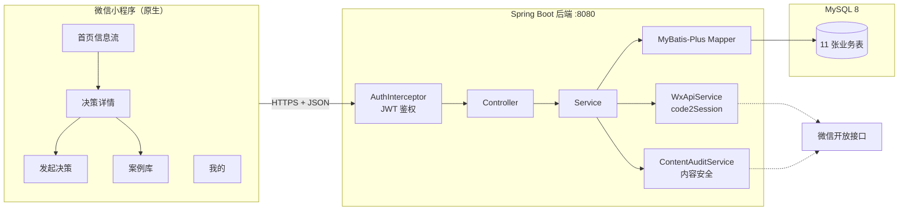

# 路口 · decision-vote

> 让走过这条路的人告诉你结果，而不是让陌生人替你数票。

一个面向**重大人生决策**的微信小程序：发起决策 → **盲投** → 全网补充**方案** → 采纳得**星星标签** → 事后**回访结局** → 沉淀为**案例库**。

[](https://openjdk.org/projects/jdk/21/)
[](https://spring.io/projects/spring-boot)
[](https://www.mysql.com/)
[](https://developers.weixin.qq.com/miniprogram/dev/framework/)
[](LICENSE)

---

## 为什么做这个

人生里的重大选择——要不要辞职读研、要不要接降薪 offer、要不要回老家——几乎都没有标准答案，只有「适不适合你」。

市面上的投票类产品都在**数人头**：让陌生人投票，票数最高的就是答案。但 100 个路过的人投的一票，凭什么等同于一个真正走过这条路的人讲的一段真实后果？

所以这个项目要做的事情不一样：**不优化投票体验，而是优化建议的可信度**。

| 常见做法 | 本项目 |
|---|---|
| 实时展示票数，后来者跟票 | **盲投**：投完才揭晓，切断从众效应 |
| 只能在发起者给的 A/B/C 里选 | **补充方案**：用户可以提出发起者没想到的第三条路 |
| 平台自己认证「专家」 | **采纳即得星**：方案被发起者采纳累积星星，系统按领域自动打标签 |
| 决策结束即话题结束 | **结局回访**：3/6/12 个月后追问「你后悔吗」，沉淀为案例 |
| 帖子沉底后不可检索 | **案例库**：相似决策自动推荐历史案例 |

最后一条是核心壁垒：**别人的热度会过期，但「和我相似的人选了 A，两年后 60% 说值得」这种数据会随时间复利增长。**

---

## 核心机制

### 1. 盲投（Blind Vote）

未投票用户在详情页只能看到 `已有 N 人参与`，看不到任何选项的票数分布；投票成功后同一请求立刻返回完整分布。

- 不显示人数会让人觉得「投进黑盒」，所以**显示人数、隐藏分布**。
- 后端在 `PostService.buildCards` 中判定 `blind`：`作者 || 已投票 || 已截止` 任一成立才揭晓。
- 前端 `detail.js` 投票成功后直接复用投票接口返回的帖子对象刷新本页，无需二次请求。

### 2. 补充方案 + 采纳 + 星星标签

```
用户提交方案 → 其他用户点赞（参考权重）→ 发起者拍板采纳 → 方案作者 +1 星，系统打领域标签
```

- 采纳权只归发起者（保含金量），点赞数作为决策依据展示，不直接决定结果。
- 星星与标签**由系统按被采纳方案所属场景累计**，不允许用户自封，避免「人生导师」标签贬值。
- 采纳后方案置顶展示。

### 3. 结局回访 → 案例库

发起者在决策落地后回填：最终选了哪个、结果如何（`值得 / 后悔 / 还在观察`）与补充说明。回填后该决策自动进入案例库，并参与相似推荐。

### 4. 相似案例推荐

发起决策页顶部会调 `/api/cases/similar` 展示同类决策的历史案例，让用户在提问前先看到「别人走过这条路，后来怎样」。

---

## 架构



**请求约定**：除 `/api/auth/login`、`/api/health` 外均需 `Authorization: Bearer <token>`；统一响应体 `{code, msg, data}`，`code=0` 为成功。

---

## 技术栈

| 层 | 技术 |
|---|---|
| 后端 | Java 21 · Spring Boot 3.2.5 · MyBatis-Plus 3.5.5 · JWT (jjwt) · MySQL 8 |
| 前端 | 微信原生小程序（无框架、无 npm 依赖） |
| 构建 | Maven Wrapper（自带 `mvnw`，无需预装 Maven） |
| 部署 | 自建服务器 + HTTPS + 已备案域名 |

---

## 目录结构

```
decision-vote/
├── backend/                          Spring Boot 后端（74 个 Java 文件）
│   ├── mvnw / mvnw.cmd               Maven Wrapper
│   ├── pom.xml
│   └── src/main/
│       ├── java/com/lukou/decision/
│       │   ├── common/               统一响应体、分页、全局异常
│       │   ├── config/               鉴权拦截器、CORS、Jackson、微信配置
│       │   ├── controller/           8 个 Controller
│       │   ├── dto/                  请求/响应对象
│       │   ├── entity/               11 个实体
│       │   ├── mapper/               MyBatis-Plus Mapper
│       │   ├── service/              业务逻辑
│       │   └── util/                 JWT、用户上下文
│       └── resources/
│           ├── application.yml
│           └── db/schema.sql         建库建表脚本
├── miniprogram/                      微信小程序（5 个页面）
│   ├── app.js / app.json / app.wxss
│   ├── project.config.json
│   ├── utils/api.js                  请求封装 + 全部接口定义
│   └── pages/
│       ├── index/                    首页信息流（场景筛选、下拉刷新、上拉加载）
│       ├── detail/                   决策详情（盲投、方案、建议、回访）
│       ├── create/                   发起决策（选项动态增删、相似案例推荐）
│       ├── cases/                    案例库（搜索、筛选、分页）
│       └── profile/                  我的（星星标签、经历档案、待回访）
├── scripts/smoke_test.py             接口链路自测（27 项断言）
└── docs/
    ├── 01-需求文档.md
    ├── 02-项目文档.md
    └── features/                     按功能维护：12 个模块 × (功能逻辑说明 + 改动记录)
```

---

## 快速开始

### 1. 初始化数据库

```bash
mysql -u root -p < backend/src/main/resources/db/schema.sql
```

脚本会创建 `decision_vote` 库与 11 张表（幂等，可重复执行）。

### 2. 启动后端

```bash
cd backend
./mvnw spring-boot:run          # macOS / Linux / Git Bash
.\mvnw.cmd spring-boot:run      # Windows CMD / PowerShell
```

健康检查：

```bash
curl http://localhost:8080/api/health
# {"code":0,"msg":"ok","data":{"status":"up"}}
```

### 3. 跑一遍接口链路（可选，推荐）

```bash
python scripts/smoke_test.py
```

用两个测试账号跑完「发布 → 盲投 → 投票 → 方案 → 点赞 → 采纳 → 星星 → 建议 → 回访 → 案例库 → 相似推荐」，逐项打印 PASS/FAIL。

### 4. 打开小程序

微信开发者工具导入 `miniprogram` 目录：

- AppID 见 `miniprogram/project.config.json`（须与小程序后台一致，否则提示无权限）
- `urlCheck` 已关闭，后端为 `http://localhost:8080/api`，导入即可跑
- 上线时把 `utils/api.js` 的 `BASE_URL` 换成已备案的 HTTPS 域名

---

## 接口清单

| 模块 | 方法 | 路径 | 鉴权 | 说明 |
|---|---|---|---|---|
| 登录 | POST | `/api/auth/login` | ✗ | `wx.login` 的 code 换 token，mock 模式下用 code 直接生成 openid |
| 健康 | GET | `/api/health` | ✗ | 存活检查 |
| 决策 | POST | `/api/posts` | ✓ | 发起决策（标题/描述/场景/2–6 选项/匿名/期限） |
| 决策 | GET | `/api/posts/feed` | ○ | 信息流分页，可按场景筛选 |
| 决策 | GET | `/api/posts/{id}` | ○ | 详情聚合：选项、票数（受盲投控制）、方案、建议、回访 |
| 决策 | GET | `/api/posts/mine` | ✓ | 我发起的 |
| 决策 | GET | `/api/posts/voted` | ✓ | 我参与过的 |
| 投票 | POST | `/api/posts/{id}/vote` | ✓ | 投票，唯一约束防重复，返回揭晓后的详情 |
| 方案 | POST | `/api/posts/{id}/solutions` | ✓ | 提交补充方案 |
| 方案 | GET | `/api/posts/{id}/solutions` | ○ | 方案列表（含点赞数、是否已采纳、作者星星） |
| 方案 | POST | `/api/solutions/{id}/like` | ✓ | 点赞 |
| 采纳 | POST | `/api/posts/{id}/adopt?solutionId=` | ✓ | 仅发起者，采纳后加星打标签 |
| 建议 | POST | `/api/posts/{id}/comments` | ✓ | 发表建议，带结果标签（值得/后悔/观察中） |
| 回访 | POST | `/api/posts/{id}/follow-up` | ✓ | 发起者回填结局 |
| 回访 | GET | `/api/follow-ups/pending` | ✓ | 待回访列表 |
| 案例 | GET | `/api/cases` | ○ | 案例库分页，支持场景筛选与关键词 |
| 案例 | GET | `/api/cases/similar` | ○ | 相似决策推荐 |
| 用户 | GET | `/api/users/me` | ✓ | 资料 + 星星总数 + 场景标签 + 经历档案 |
| 用户 | PUT | `/api/users/me` | ✓ | 更新昵称等 |
| 用户 | POST | `/api/users/me/experiences` | ✓ | 新增经历档案 |
| 用户 | DELETE | `/api/users/me/experiences/{id}` | ✓ | 删除经历档案 |

> ○ = 可选鉴权：带 token 时返回「我是否投过票」，不带也能访问。

---

## 数据模型

| 表 | 说明 |
|---|---|
| `dv_user` | 用户（openid、昵称、匿名偏好） |
| `dv_experience` | 经历档案（场景、当时选择、距今几年、结果） |
| `dv_post` | 决策帖（标题、描述、场景、状态、期限、匿名） |
| `dv_option` | 选项 |
| `dv_vote` | 投票（`post_id + user_id` 唯一，防重复投） |
| `dv_comment` | 建议（带结果标签） |
| `dv_follow_up` | 结局回访（最终选择、结果、补充说明） |
| `dv_solution` | 补充方案（含 `adopted` 标记） |
| `dv_solution_like` | 方案点赞 |
| `dv_user_credit` | 星星与场景标签（按 user + scene 累计） |
| `dv_report` | 举报 |

---

## 配置

敏感配置通过环境变量注入，默认值仅供本地开发：

| 变量 | 默认 | 说明 |
|---|---|---|
| `DB_USERNAME` / `DB_PASSWORD` | `root` / `root` | 数据库账号密码 |
| `JWT_SECRET` | 开发用占位值 | **生产必改** |
| `WX_APPID` / `WX_SECRET` | 空 | 小程序密钥，**生产必填** |
| `WX_MOCK` | `true` | `true` 时免真实 AppID 本地联调 |
| `AUDIT_MOCK` | `true` | `true` 时仅本地关键词过滤，不调微信内容安全 |

---

## 文档

| 文档 | 内容 |
|---|---|
| [需求文档](docs/01-需求文档.md) | 产品定位、核心机制、29 个功能点（编号/优先级/状态/验收标准）、页面清单、业务规则、合规要求 |
| [项目文档](docs/02-项目文档.md) | 架构、11 张表字段与约束、完整接口清单、登录时序、开发计划、上线检查清单、已知问题 |
| [功能文档索引](docs/features/README.md) | **按功能维护**：12 个模块，每个含「功能逻辑说明」（9 节）与「改动记录」（追加式） |

功能模块：微信登录与身份 · 个人资料与经历档案 · 发起决策 · 决策信息流 · 投票与盲投 · 提供方案与点赞 · 方案采纳与星星标签 · 过来人建议 · 决策回访与结局归档 · 案例库与相似推荐 · 内容安全与举报 · 前端工程骨架与请求层

---

## 当前进度

| 模块 | 状态 |
|---|---|
| 后端接口 | ✅ 8 组 20 个接口，编译通过 |
| 数据库 | ✅ 11 张表，已初始化 |
| 小程序页面 | ✅ 首页 / 详情 / 发起 / 案例库 / 我的 五页齐全 |
| 接口联调 | ✅ `smoke_test.py` 27 项断言全通过 |
| 上线准备 | ⬜ 域名 ICP 备案、HTTPS、关 mock、接真实内容安全、补举报接口 |

### Roadmap

- [ ] 举报接口 + 前端入口（UGC 过审必需）
- [ ] 回访订阅消息推送（到点主动触达，而非进「我的」页才看到）
- [ ] 方案列表排序修正（已采纳置顶）
- [ ] 经历档案年限映射修正
- [ ] 真机视觉走查与样式微调
- [ ] 案例库聚合统计（「某类人做某选择，N 年后后悔率」）

---

## 已知限制

- 当前 `WX_MOCK=true`，登录走本地模拟 openid，未接入真实 `code2Session`
- `AUDIT_MOCK=true`，内容安全仅本地关键词过滤
- 举报仅有表与 Mapper，未暴露接口
- 样式按 750rpx 规范编写，尚未在真机/模拟器逐页视觉验证

---

## License

[MIT](LICENSE)
